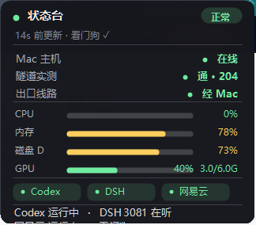

# 状态台 · Status Island

一个 Windows 桌面「灵动岛」风格的常驻小面板：平时是一枚 232×40 的半透明胶囊，上下翻页轮播关键信息；鼠标移上去展开成完整面板，移开自动收起。




## 它显示什么

| 区域 | 内容 |
|---|---|
| 隧道 | Mac 主机在线状态（Tailscale）、SOCKS5 实际连通性（真的去打 `gstatic/generate_204`）、ChatGPT 当前出口（经 Mac / 机场 / 直连） |
| 系统 | CPU、内存、磁盘 C/D 占比（带进度条，<65% 绿 / <88% 黄 / 更高红）、GPU 利用率与显存（NVIDIA） |
| 服务 | Codex（进程）、DSH（端口）、网易云（进程）。**没在运行就不显示**；运行中显示 `空闲` / `工作中`（按 CPU 增量判定），并记录「上次活动」时间 |
| 底栏 | 上下翻页：CPU/内存 → 磁盘 → GPU → Codex+DSH 状态 → 网易云+看门狗 → 隧道+出口 → 上次活动 → 建议 |

右上角胶囊表示总体健康度：`正常 / 降级 / 异常 / 离线`。

## 安装

```powershell
git clone https://github.com/<you>/status-island.git
cd status-island
powershell -ExecutionPolicy Bypass -File .\install.ps1
```

安装脚本做三件事：把 `StatusIsland.ps1` + `launcher.vbs` 复制到 `%LOCALAPPDATA%\StatusIsland\`；生成 `config.json` 模板；创建「桌面」和「开机自启」两个快捷方式。

装完直接双击桌面「状态台」即可。不想装快捷方式也能试跑：

```powershell
powershell -File "$env:LOCALAPPDATA\StatusIsland\StatusIsland.ps1" -Once   # 采一次数据，打印 JSON
```

## 配置（`%LOCALAPPDATA%\StatusIsland\config.json`）

```json
{
  "macHost": "100.64.0.1",
  "socksPort": 1080,
  "clashGroup": "选择节点",
  "clashMacProxyName": "SG-Mac-SOCKS5",
  "tailscaleExe": "C:\\Program Files\\Tailscale\\tailscale.exe",
  "nvidiaSmi": "C:\\Windows\\System32\\nvidia-smi.exe",
  "dshPort": 3081,
  "codexProcess": "ChatGPT",
  "neteaseProcess": "cloudmusic",
  "watchdogLockPath": "",
  "tunnelStartScript": ""
}
```

| 字段 | 说明 | 留空/缺失时 |
|---|---|---|
| `macHost` | Mac 在 Tailscale 里的 IP | 用内置默认值 |
| `socksPort` | 本机 SOCKS5 端口（`ssh -D` 转发出来的） | 1080 |
| `clashGroup` | Clash 里决定 ChatGPT 走向的 selector 名 | `选择节点` |
| `clashMacProxyName` | 该 selector 选中「走 Mac」时的代理名，用来判断当前是否经 Mac | `SG-Mac-SOCKS5` |
| `tailscaleExe` | tailscale.exe 路径 | 标准安装路径 |
| `nvidiaSmi` | nvidia-smi.exe 路径 | 标准路径 |
| `dshPort` | 要探测的本地端口（示例里是 DSH 的 3081） | 3081 |
| `codexProcess` | 进程名（不带 .exe） | `ChatGPT` |
| `neteaseProcess` | 进程名（不带 .exe） | `cloudmusic` |
| `watchdogLockPath` | 可选：隧道看门狗的锁文件路径，用来显示 `看门狗 ✓/✗` | 空 = 不显示 |
| `tunnelStartScript` | 可选：右键「重连 Mac 隧道」要执行的 ps1 | 空 = 菜单项不动作 |
| `clashExe` | 可选：右键「打开 Clash Verge」的程序路径或命令 | `clash-verge.exe` |
| `busyThreshold` | 判定「工作中」的 CPU 阈值（相对单核，0.06 = 6%） | 0.06 |

配置里只写这台机器的路径/IP，不涉及任何凭据；SSH 私钥只由那个 `tunnelStartScript` 自己使用。

## 依赖

- Windows 10/11 + 自带 Windows PowerShell 5.1（**不需要**装 PowerToys、不需要 pwsh 7）
- 可选组件（缺了就少一块信息，不会报错）：
  - Tailscale —— 显示 Mac 在线状态
  - Clash Verge（mihomo）—— 读取 ChatGPT 当前出口；通过 mihomo 的**命名管道** API 查询，不依赖 9090 端口
  - `ssh -D` 建的 SOCKS5 隧道 —— 隧道健康区块
  - nvidia-smi —— NVIDIA GPU 利用率/显存

## 实现要点

- **UI 与采集分离**：主进程只渲染，worker 子进程负责采集并写 `status.json`；UI 每 1.2s 读缓存，所以探针再慢也不会卡界面。
- **全 GDI+ 自绘**：无边框 Form + 圆角 Region + 双缓冲，没有子控件（所以整窗可拖、无控件闪烁）。
- **展开/收起**：30ms 定时器把宽高向目标插值，右侧锚定向左摊开；同时检测光标是否在窗口内决定目标态。
- **上下翻页**：每页文字在一个 16~18px 高的裁剪区内做垂直滑动切换（`DrawString` + `SetClip`），比横向跑马灯更好读。
- **静默启动**：快捷方式指向 `wscript.exe launcher.vbs`，VBS 用 `WScript.Shell.Run(..., 0, False)` 起 PowerShell，避免 Windows 11 把控制台丢进 Windows Terminal 弹黑窗。
- **CPU/内存**：`Win32_PerfFormattedData_PerfOS_Processor` 与 `Win32_OperatingSystem`；磁盘用 `Win32_LogicalDisk`。

## 已知限制

- 仅 Windows（WinForms + Windows PowerShell）。
- GPU 实时利用率只支持 NVIDIA（走 nvidia-smi）；其他显卡会省略这一项。
- 位置固定在主屏右上角，可用鼠标拖动改变位置（重启后回到默认位置）。
- 展开时机靠光标进入窗口判定，没有点击穿透；如果面板挡住了要点的东西，移开光标它就会收起。

## License

MIT
